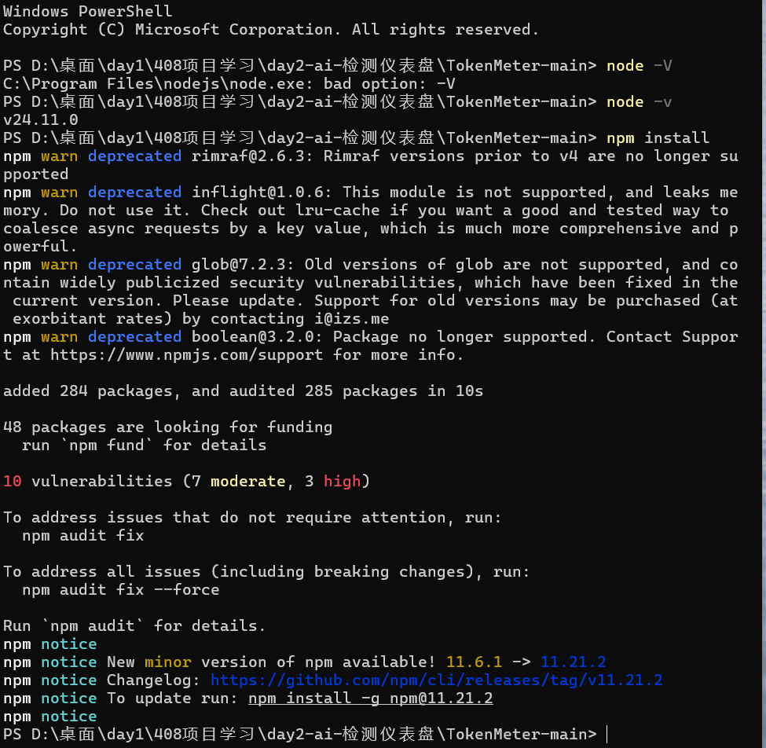
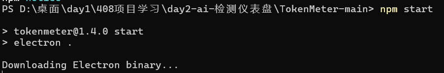
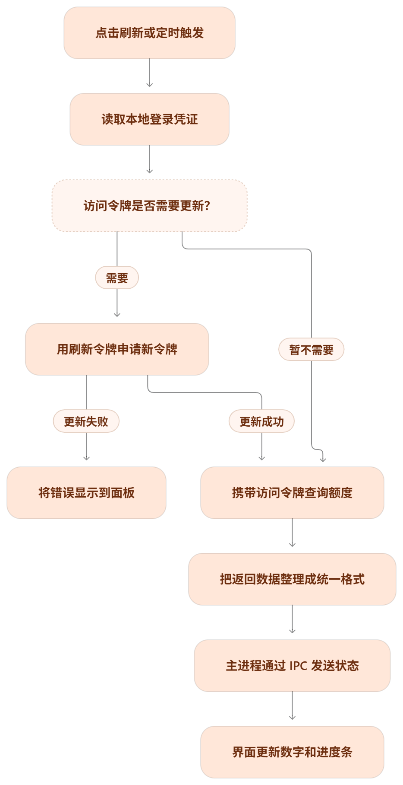
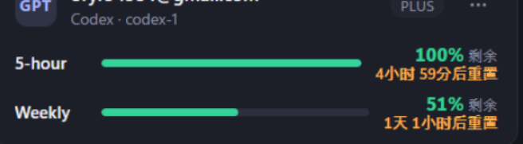
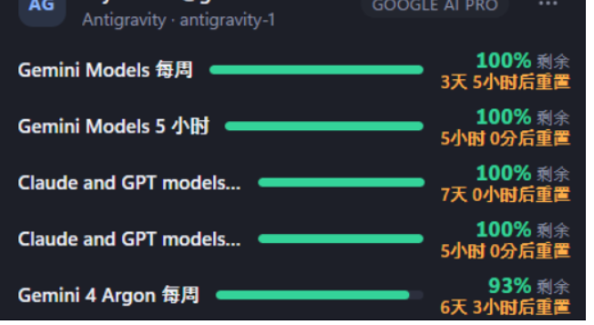
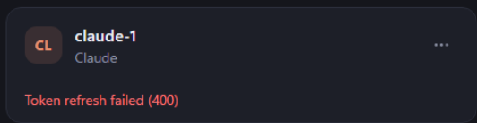

## day2—TokenMeter（额度仪表盘）

来源：TokenMeter v1.4.0 源码实读

https://github.com/HSoo-Kim/TokenMeter

这三条命令，你可以记成：**查版本 → 装依赖 → 启动项目。**

1. **`node -v`：查看 Node.js 的版本。**

   相当于问电脑：“你现在用的是哪个版本的 Node.js？”

   返回 `v某个版本号`，说明当前命令窗口能找到并运行 Node.js。注意 **`-v` 是小写 v**。

2. **`npm install`：安装项目需要的依赖。**

   你下载了源码，还需要准备它用到的工具。

   npm 会按照项目里的 **package.json 清单**安装依赖，放进 **node_modules 文件夹**。

   在 TokenMeter 里，包括 Electron 等工具。

   **依赖装好后，平时启动一般不用重新安装。**

3. **`npm start`：按项目规定的方式启动。**

   npm 会查看 package.json 里面的 **start 启动命令**，然后执行它。

### 一、技术栈分层（从下往上）

| 层       | 是什么                                                       | 说人话                                                       |
| -------- | ------------------------------------------------------------ | ------------------------------------------------------------ |
| 语言     | JavaScript                                                   | 全项目一种语言写到底，界面和逻辑都是它                       |
| 运行时   | Node.js                                                      | 让 JS 离开浏览器、能在电脑上读文件发请求；自带 fs/os/crypto/http/fetch 等内置工具箱 |
| 框架     | Electron 44                                                  | 把"网页界面（Chromium）＋Node 系统能力"打包成桌面应用；VS Code、Antigravity 本体也是这套 |
| 打包     | electron-builder 26 ＋ NSIS                                  | 把源码组装成 `TokenMeter-Setup-1.4.0.exe` 安装包             |
| 数据接口 | OAuth 2.0 刷新令牌、REST 用量接口、Google 内部接口、本机回环 RPC、GraphQL | 它消费的"别人的接口"，见第四节                               |
| 本地数据 | 凭证文件（auth.json 等）、config.json                        | 各 CLI 自己存的登录文件＋它自己的账号配置                    |

一个优雅点（已核实）：***\*这个应用运行时零第三方依赖\****——package.json 里没有 dependencies，只有开发用的 electron 和 electron-builder。今天 `npm install` 装的 284 个包，几乎全是 Electron 本体和打包工具链，应用代码只用 Node 内置模块。

### 二、文件逐个讲（岗位制）

| 文件                 | 岗位                         | 干什么                                                       |
| -------------------- | ---------------------------- | ------------------------------------------------------------ |
| `package.json`       | 身份证＋零件清单＋遥控器菜单 | 写着名字、版本、入口（main.js）、命令脚本（start/dist/test）、要装的开发依赖、打包配置。今天敲的每条 npm 命令都是在执行它里面的条目 |
| `package-lock.json`  | 零件的精确版本锁             | 把每个依赖的版本钉死，保证换台电脑装出来一模一样             |
| `main.js`            | 主进程·总管                  | 建托盘和面板窗口、管 60 秒定时器、存配置（%APPDATA%\TokenMeter\config.json）、回答页面发来的请求、拉起官方 CLI 登录。它是 Electron 的"主进程" |
| `index.html`         | 渲染进程·脸                  | 就是他看到的面板：卡片、进度条、百分比。它自己碰不到系统，只能看和画 |
| `preload.js`         | 安全桥·传话筒                | 页面和主进程之间唯一的通道（已逐行读，全文 15 行）：用 contextBridge 只开放一张白名单——onState（收数字）、refresh（喊刷新）、menu、setHotkey 等。页面想干任何事只能敲这几扇门，这是 Electron 的安全设计 |
| `providers.js`       | 抄表总管（Codex/Claude）     | 读 CLI 的凭证文件→令牌快过期先刷新→带令牌查官方用量接口→把各家五花八门的返回***\*归一化\****成统一格式 `{loggedIn, name, plan, windows:[{label, usedPct, resetsAt}]}` |
| `antigravity.js`     | Antigravity 抄表员           | 开头注释自述 "Read-only quota access to the running Antigravity language server"：找正在运行的 language_server 进程和它的本机端口，用本机回环 RPC 问额度，把 remainingFraction 换算成已用百分比。不复制任何凭证 |
| `gemini.js`          | Gemini CLI 抄表员（旧）      | 读 ~/.gemini/oauth_creds.json 查 Code Assist 内部接口；个人版 Gemini CLI 登录已被 Google 取消，这份是给存量 Code Assist 账号的 |
| `gemini-web.js`      | Gemini 网页版抄表员          | 在应用内开一个隔离的浏览器会话让他登 Google，再查网页版的用量（GraphQL） |
| `keychain.js`        | 钥匙串管理员（仅 macOS）     | 在 Mac 上通过系统 `security` 命令读写登录钥匙串里 Claude Code 的凭证；Windows 用不上（Windows 走文件） |
| `i18n.js`            | 翻译词典                     | 英/韩/中三套文案；面板右上角那个"中"字切换、"5 小时/每周"这些标签都出自它 |
| `updates.js`         | 更新检查员                   | 去 GitHub Releases 看有没有新版本，下载后校验 SHA-256 再装   |
| `TokenMeter.cmd`     | 一键启动脚本                 | Windows 下双击等于 npm start（仍会带控制台窗口）             |
| `build/`             | 打包素材                     | 图标（icon.ico 等）和生成图标的脚本 make-icon.js             |
| `.github/workflows/` | 自动流水线                   | 作者在 GitHub 上的自动打包/发版配置                          |
| `test-*.cjs`         | 体检脚本                     | 作者给各抄表员写的自动化测试，npm 命令里的 test:providers 就跑它们 |

### 三、整个流程

先给你整个流程，再一次深入一个环节。

**先抓住它的本质：额度数据在服务商那里，TokenMeter 负责取得数据、整理数据、显示数据。**

比如面板显示“已用 40%”，我们要追踪的就是：**这个 40% 怎么从服务商的服务器，来到你电脑上的进度条？**

先把这条线翻译成人话：

1. **有人发起任务。**
   你点刷新，或者定时器到点，程序开始查额度。没有触发，代码就不会凭空执行这项工作。

2. **程序准备证明“我代表哪个账号”。**
   它读取相应 CLI 已保存的登录凭证。

   里面的访问令牌，可以先理解为一张有时效的“通行证”。

   

   

   

   **CLI：命令行工具。** 比如 Codex CLI，你通过输入命令使用它。

   **两种操作入口**：

   1. **图形界面：点按钮办事。**
   2. **命令行界面（CLI）：输入命令办事。**

   你打开软件，登录账号。

   软件在电脑里保存登录凭证。

   TokenMeter 按它支持的方式读取凭证，再去查额度。

   

   **Token：登录后的临时凭证。** 程序拿它向服务器证明身份，有有效期。

   你已经登录 Codex 为例：

   1. **Codex 把你账号的 Token 保存在电脑里**，相当于把通行证放进抽屉。
   2. **TokenMeter 读取电脑里的这个文件**，拿到通行证。这一步在本机完成。
   3. **TokenMeter 再通过网络，带着通行证去问服务器：“我的账号用了多少额度？”**
   4. 服务器返回数据，它显示成进度条。

   

3. **通行证快过期，就尝试续期。**
   用刷新令牌向登录服务申请新的访问令牌。

   续期成功，继续查询；失败，就得到错误。你记录里的 `Token refresh failed (400)`，对应的就是这个环节。

    

   续期请求： 带着刷新令牌，申请新的访问令牌。

   额度请求： 带着访问令牌，查询用了多少额度。

4. **向用量接口询问额度。**
   程序发送网络请求，带上访问令牌。服务端验证身份后，返回这个账号的用量信息。
   **接口，可以先理解为服务端留给程序的办事窗口：按约定提交请求，取得规定格式的结果。**

   TokenMeter 发网络请求，带上 Token → Claude 服务器验证身份 → 成功就返回额度数据；失败就显示对应错误。

   ps：请求到达服务器时，就有两类信息：

   - **Token：** 用来识别你登录的是哪个账号。
   - **出口 IP：** 用来推断这次连接来自哪个大致地区。

   Claude 官方明确说明，会使用 **IP 和其他信号判断国家／地区**，用于安全检查和防止滥用。

   所以，**TokenMeter 虽然只是查额度，联网时也可能被纳入安全检查。**

5. **把各家的结果整理成同一种格式。**
   假设一家返回“已用 40%”，另一家返回“剩余 60%”，程序可以统一整理成“已用 40%”。这样，界面只需要掌握一种画进度条的方法。

6. **把整理好的结果交给界面。**
   Electron 的主进程负责系统能力和任务协调，渲染进程负责窗口中的网页界面；两边通过 IPC，也就是进程间通信，传递消息。`preload.js` 用来向页面开放指定能力，**它是脚本，不是第三个独立进程。**

   假设 Claude 返回“已用 **40%**”，接下来：

   1. **主进程：负责查。**
      后台查询代码拿到结果：“这个账号用了 40%。”
   2. **IPC：负责传消息。**
      把“已用 40%”这份数据，从主进程传给负责界面的渲染进程。**这次是在你电脑内部传递，不是再请求 Claude 服务器。**
   3. **渲染进程：负责画。**
      界面收到数据后，把文字改成“40%”，再把进度条填到 40%。

   **那 preload.js 干什么？**

   它是**运行在渲染进程里的桥接代码**，给页面开放指定功能，比如“接收后台发来的额度结果”。页面通过这些功能和后台联系，所以它不用直接掌握读取登录文件等系统能力。

7. **界面把数据画出来。**
   比如拿到 `usedPct: 40`，就显示“40%”，并把进度条填到相应位置。

这里最值得学的，是下面三种设计思路：

- **为什么需要令牌？** 服务端需要识别请求者，并判断他能查看什么。
- **为什么需要统一格式？** 各家接口不同，统一后，界面就能复用。
- **为什么拆开查询和显示？** 查询方式变化时，界面可以少改；调整外观时，也不用重新写登录和查询逻辑。

你下载、安装依赖、启动成功，已经走通了“让代码运行”的过程。

#### 学习记录：

> **现象：** 面板出现“已用 40%”。
> **来源：** 服务商返回的用量数据。
> **取得条件：** 有效登录凭证、网络可达、接口接受请求。
> **中间处理：** 解析返回结果，整理成统一格式。
> **最终展示：** 把状态传给界面，更新文字和进度条。

### 四、它消费的接口清单（全部只读）

| 对象             | 接口                                                     | 方式                                                         |
| ---------------- | -------------------------------------------------------- | ------------------------------------------------------------ |
| Codex            | chatgpt.com/backend-api/wham/usage                       | 本机 auth.json 的令牌                                        |
| Claude           | api.anthropic.com/api/oauth/usage                        | 本机 .credentials.json 的令牌（刷新走 console.anthropic.com/v1/oauth/token） |
| Gemini CLI（旧） | cloudcode-pa.googleapis.com/v1internal:retrieveUserQuota | oauth_creds.json                                             |
| Antigravity      | 127.0.0.1 上 language_server 的 LanguageServerService    | 本机回环，不带凭证文件                                       |
| Gemini 网页版    | 网页版用量 GraphQL                                       | 应用内隔离会话                                               |

他面板上 claude-1 的 "Token refresh failed (400)" 至此完全对上：providers.js 拿那份过期凭证去 Anthropic 令牌接口刷新，被回了 400。

### 这次学习的定位是：**开源项目运行复现与原理学习**

#### 一、一分钟介绍

> 我学习并运行复现了一个叫 TokenMeter 的开源桌面额度仪表盘。它把多个 AI 服务账号的额度和重置时间放在同一个面板中，方便用户查看。
>
> 我目前主要完成了环境搭建、项目启动和数据流程梳理。重点学习的是 Codex、Claude 这条查询路线：读取本地登录凭证，需要时刷新访问令牌，再向服务商的用量接口发送请求，把返回结果整理成统一格式，最后通过 Electron 的进程间通信更新界面。
>
> 学习过程中，我遇到了 Claude 的 Token refresh failed (400)。我已经能把错误定位到令牌续期请求这一环节，但目前还没有确认服务器拒绝请求的具体原因，也没有完成修复。
>
> 这次学习让我把文件读取、网络请求、身份认证、进程通信和界面显示串成了一条具体的数据流。下一步，我准备选择一个小功能进行修改和验证，形成自己的代码贡献。

练习方法：先看懂，再合上笔记用自己的话说。不要强背还解释不清的词。

#### 二、第一轮：最先练熟的七个问题

##### 1. 这个项目解决什么问题？

**老师可能问：**“你介绍一下这个仪表盘，它有什么用？”

**可以这样回答：**

> 用户使用多个 AI 服务时，需要分别打开各家的界面查看额度。这个项目把多个账号的额度、重置时间和异常状态集中展示到一个桌面面板中。它主要负责采集、整理和显示数据，额度的权威信息来自服务商。

**本质：**把分散的数据放到一个统一的观察入口。

**追问准备：**它显示的是账号的用量限制，不等于自己准确统计了用户所有对话消耗的文本 token。

##### 2. 哪些工作是你自己完成的？

**老师可能问：**“这是你自己开发的吗？你具体做了哪一部分？”

**可以这样回答：**

> 这是开源项目，我这次做的是运行复现和原理学习。我完成了依赖安装、项目启动，结合运行现象梳理了一次额度刷新的完整流程，也学习了主要文件之间的调用关系。目前还没有独立新增功能，这部分是下一步准备补上的。

**本质：**清楚区分原作者的实现和自己的学习、实验、改动。

**如果老师追问代码贡献：**目前没有记录的代码改动，就直接说明。把“看懂了什么”讲具体，比把复现说成原创更能经得住追问。

##### 3. 点击刷新后，整个过程是什么？

**老师可能问：**“你从点击按钮开始讲，直到进度条更新。”

**可以这样回答：**

> 用户点击刷新后，页面通过 preload 开放的方法向主进程发消息。主进程开始查询，对 Codex、Claude 这类账号读取本地凭证，检查访问令牌是否需要更新，需要时先申请新令牌，然后携带访问令牌查询额度。各提供方模块把结果整理成统一格式，主进程把状态发回页面，页面更新数字和进度条。

**再补一句：**

> 定时刷新也会进入查询流程，只是触发来源不同。Antigravity 等其他接入方式有不同的数据获取路线，不能把所有服务都说成读取同一种凭证文件。

**记忆顺序：**触发 → 读凭证 → 必要时续期 → 查额度 → 统一格式 → 传状态 → 更新界面。

##### 4. JavaScript、Node.js、Electron 分别是什么？

**老师可能问：**“为什么用了这几个东西？它们有什么区别？”

**可以这样回答：**

> JavaScript 是编写逻辑的语言。Node.js 提供在浏览器之外运行 JavaScript 的环境，以及文件读取等系统能力。Electron 把网页界面和桌面应用能力结合起来，让这个项目能做窗口、托盘和快捷键。界面的结构和样式还使用了 HTML、CSS。

**本质：**语言、运行环境、桌面应用框架属于不同层次。

**为什么选择 Electron？**

> 它可以复用网页界面的开发方式，并提供桌面窗口、托盘等能力，适合这个小面板。代价是需要携带 Chromium 等运行组件，安装包和内存开销通常会比简单的原生小工具更大。这里是对技术选择的分析，不是我对本项目做过性能对比实验。

##### 5. Token 是什么？它和 CLI 有什么关系？

**老师可能问：**“程序怎么知道该查哪个账号？CLI 是不是 Token？”

**可以这样回答：**

> 这里的 Token 指登录令牌，是服务端用来识别和授权请求的凭证。CLI 指命令行界面；Codex CLI 是采用命令行界面的 Codex 工具。两者不是同一个概念。客户端登录后，可以把令牌保存在本地；TokenMeter 按它支持的位置和格式读取凭证，再查询额度。

**必须能分清：**

- CLI：一种操作界面。
- Codex CLI：具体的软件工具。
- 登录 Token：身份认证凭证。
- 大模型文本 token：计量文本的单位，和登录令牌不是一回事。

**补充：**点图标打开图形界面软件，不代表一定启动了 CLI。不同客户端的凭证也不一定互通。

##### 6. 主进程、渲染进程、IPC、preload 怎么配合？

**老师可能问：**“后台查到结果后，怎么显示到页面？”

**可以这样回答：**

> 主进程负责窗口管理、查询协调等工作；渲染进程负责页面显示。它们通过 IPC，也就是进程间通信，传递刷新指令和查询结果。preload 是在渲染进程中运行的桥接脚本，用 contextBridge 向页面开放指定方法，比如刷新和接收状态，它不是第三个独立进程。

**具体追踪一个数字：**

- 提供方模块得到“已用 40%”，形成 usedPct 为 40 的统一数据。
- 主进程通过 state 消息发送查询状态。
- 页面通过 preload 开放的 onState 接收。
- 当前项目页面计算剩余比例为 100 − 40 = 60，显示“剩余 60%”。

**源码中的对应位置：**

- 页面点击刷新：调用 api.refresh()。
- preload：把 refresh 转为 ipcRenderer.invoke('refresh')。
- 主进程：处理 refresh 消息，调用 poll(true)。
- 主进程 push()：通过 webContents.send('state', ...) 发状态。
- preload 的 onState：把状态交给页面回调。
- 页面：重新渲染账号卡片。

**本质：**把数据采集和界面展示分开，通过受控通信交接结果。

##### 7. 你遇到的 400 错误，到底说明什么？

**老师可能问：**“你说遇到问题了，怎么定位？解决了吗？”

**可以这样回答：**

> 我看到的提示是 Token refresh failed (400)。结合源码，这个错误是在令牌续期接口返回非成功状态时产生的，所以我可以把失败环节定位到续期请求。400 本身不能直接证明账号被封，也不能单凭它确定刷新令牌失效。我还需要查看脱敏后的错误响应，核对请求参数和凭证状态。目前我定位了环节，但没有确认根因或完成修复。

**本质：**错误现象、失败环节、具体原因、最终修复，是四件不同的事。

**不能直接说：**“400 就是网络不好”“400 就是被封号”“这个问题我已经解决了”。

------

#### 三、第二轮：老师顺着问，你怎样接住

##### 8. 为什么需要两种令牌？

**答：**

> 访问令牌用于携带身份授权访问资源接口；刷新令牌用于向认证服务申请新的访问令牌。它们职责不同。访问令牌有有效期，刷新令牌也可能被撤销或失效，不能理解为永久有效的万能凭证。

**结合本项目：**访问令牌用于查额度，刷新令牌用于续期。续期成功后，代码会保存更新后的凭证。

##### 9. “统一格式”有什么意义？

**答：**

> 不同服务商返回的字段和额度口径不同。如果页面直接处理各家的原始响应，就需要写很多分支。提供方模块先转换成共同的数据结构，页面就能复用同一套展示逻辑。新增服务时，主要补充对应的数据适配模块。

**例子：**

- A 服务直接给“已用 40%”。
- B 服务给“剩余比例 0.6”。
- 两者都可以转换成“已用比例 40%”。
- 当前界面再统一换算为“剩余 60%”展示。

**注意：**不同时间窗口、不同服务商的额度仍然分开展示，不能因为格式统一就把它们相加成一个总余额。

##### 10. 多账号是逐个查询，还是一起查询？

**答：**

> 当前 main.js 使用 Promise.all 发起多个账号的异步查询，可以让网络等待重叠。每个账号内部有自己的异常处理，一个账号失败可以记录自己的错误，其他账号仍有机会得到结果，最后一起推送本轮状态。

**继续追问：**

- 这是异步 I/O 并发，不能据此说“每个账号都启动了一个新线程”。
- polling 标记用于避免上一轮未结束时又开启一整轮查询。
- 本轮等待所有账号任务结束后统一推送，因此慢账号可能影响这一轮整体结果到达页面的时间。
- 如果要改善，需要考虑超时控制或按账号逐步更新；这些是改进方向，不是我已经完成的功能。

##### 11. 400、401、429 应该怎么区分？

**答：**

- **400：**请求存在问题。必须结合具体接口和响应正文判断原因。
- **401：**身份认证未通过。本项目 Codex、Claude 用量请求遇到 401 后，会尝试刷新令牌并重试一次。
- **429：**触发请求频率等限制。本项目读取 Retry-After 信息，设置账号下一次自动查询的等待时间。

**源码细节：**手动刷新走 force=true，当前逻辑会跳过 notBefore 冷却检查，因此不能回答“任何刷新都严格等待冷却结束”。

**本质：**先区分失败类型，再决定补登录、续期、等待还是检查请求，而不是遇到失败就无限重试。

##### 12. HTTP 请求和 IPC 通信是一回事吗？

**答：**

> 不是。这里查询 Claude、Codex 额度的 HTTP 请求，是程序通过网络访问远端服务；Electron 的 IPC，是本机主进程和渲染进程之间交换消息。两者都在传递信息，但通信双方和使用的机制不同。

**快速判断：**

- “向 Claude 询问额度”：远端网络请求。
- “把额度结果交给面板”：本机 IPC。
- “从磁盘读取登录文件”：本机文件操作。

##### 13. 你运行项目用的三条命令，各干什么？

**答：**

- **node -v：**查看当前可用 Node.js 的版本，v 是小写。
- **npm install：**按项目清单和锁文件安装依赖，通常放进 node_modules。
- **npm start：**执行 package.json 中 scripts.start 规定的启动命令。

**本项目：**start 的值是 electron .，即用 Electron 启动当前目录的项目；main 字段指向 main.js。

**追问：**

- 已经安装好依赖，之后重新运行项目，通常使用 npm start。
- 依赖清单变更、node_modules 缺失、换环境等情况下，才需要重新准备依赖。
- 本项目安装的包包括 Electron 和构建工具及其传递依赖，不能把安装包数量等同于作者直接使用的第三方业务库数量。

##### 14. 它是实时更新的吗？进度条是自己统计的吗？

**答：**

> 当前项目默认每 60 秒发起一次额度查询，也支持手动刷新，因此更准确地说是定时轮询，不是服务端每次额度变化都主动推送。页面还有自己的重新渲染定时器，但重新渲染不等于重新向服务商查询。

**进度条来源：**

> 主要依据服务商返回的额度比例和重置时间。提供方模块做格式转换，页面做显示换算。它并没有因此掌握服务商全部的内部计费和额度计算规则。

##### 15. 读取 Token 有没有安全问题？

**答：**

> 有安全边界需要考虑。Token 是登录凭证，应避免进入公开笔记、截图、仓库或日志。页面只需要额度等展示数据，不需要取得原始令牌。网络请求携带令牌时，服务端可以把请求与账号关联，也能观察出口 IP 等连接信息。只读查询并不意味着请求不可见。

**关于地区和封号：**

> 官方会使用 IP 和其他信号判断大致地区并进行安全检查。但不能把一次查询或一个 400 错误直接当成封号证据，也不能说只允许美国。具体判定规则和第三方工具的使用边界，需要依据官方说明，不能保证绝对安全。

**“只读”的准确含义：**额度查询的业务目的主要是读取用量信息，但程序并不是完全不写磁盘；令牌续期成功后会写回凭证，应用也会保存配置。

##### 16. 为什么不让页面直接读文件、拿令牌、发请求？

**答：**

> 当前设计把系统能力和凭证处理放在后台，把展示放在页面。这样能减少页面直接接触敏感凭证和系统接口的机会，也让界面变化与服务商接口变化相对独立。preload 只开放页面需要的方法，而不是把全部 Node.js 或 IPC 能力直接交给页面。

**边界：**分层和 contextBridge 可以缩小暴露面，但不是“用了 Electron 就绝对安全”。具体还要看开放了什么方法、输入怎样校验、页面是否可信等。

##### 17. 你做过哪些测试？准备怎么测试？

**当前能诚实回答：**

> 我目前主要完成了手动启动和运行现象观察，记录了续期失败，并结合源码定位了流程环节。我知道仓库里有测试脚本，但没有运行结果记录的部分，不能说已经全部测试通过。

**后续可做的验证：**

- 正常返回额度时，统一结果和页面比例是否正确。
- 没有凭证时，是否显示需要登录。
- 续期接口返回 400 时，是否明确显示续期失败。
- 用量接口返回 401 后，是否只按设计重试。
- 返回 429 时，自动查询是否遵守冷却。
- 请求超时或响应格式异常时，其他账号是否仍能更新。
- 日志和 IPC 数据里是否意外包含敏感令牌。

**做法：**尽量用虚构数据和本地模拟响应验证错误路径，避免为了测试不断请求真实账号。已有测试文件属于原仓库，新增测试和实际运行结果需要另行记录。

##### 18. 如果让你改进，你会先做什么？

**可以这样回答：**

> 我想先改进错误诊断，把凭证读取、令牌续期、额度查询和数据解析这几个阶段区分开。比如同样是失败，页面明确告诉用户“续期失败”还是“额度查询失败”，并保留脱敏错误信息和最后成功更新时间。完成后，再用模拟响应验证正常、400、401、429 和网络异常等情况。

**实施前先核对：**

- 原项目已经有部分错误提示和最后更新时间，不能把已有功能当成自己的新增功能。
- 新贡献要写清楚“改前什么表现、改后什么表现”。
- 只完成了设计就说设计，代码改完并验证后再说实现。

**建议先做这一件小改动。** 不必同时承诺重做登录系统、接入所有平台、搭建复杂后端和数据库。

##### 19. 这个项目与你学过的 408 知识有什么联系？

**可以从三个地方展开：**

- **进程与 IPC：**主进程和渲染进程有不同职责，需要通信交接数据。preload 是脚本，不能把每个 JavaScript 文件当成独立进程。
- **I/O 与并发：**网络请求需要等待响应，异步方式可以让多个请求的等待时间重叠。异步并发不等于每个请求都使用一个专属线程。
- **文件与权限：**程序读取本地配置和凭证文件，涉及路径、权限、读写失败和敏感信息保护。

**边界：**Electron 的主进程不是操作系统内核，也不能把“主进程”理解成系统中权限最高的进程。

##### 20. 老师问到你还没学过的部分怎么办？

**回答结构：**说明已知范围 → 说清尚未确认的点 → 给出具体核查方法。

**例子：**

> 我目前确认的是，这个错误出现在令牌续期接口，状态码是 400。具体是令牌失效还是请求参数问题，我还没有足够证据。我会先查看脱敏后的响应正文，再对照请求字段和认证流程，逐项定位。

**不要做的事：**用一个熟悉的词去替代不知道的原因，例如把所有错误都说成网络问题，或者把任何第三方接入都说成官方开放接口。